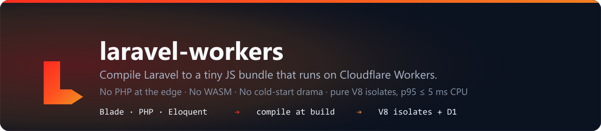

# laravel-workers

> Compile your Laravel app to a tiny JS bundle that runs on Cloudflare Workers.
> No PHP at the edge. No WASM. No cold-start drama.

[](https://github.com/arfoux/laravel-workers/actions/workflows/ci.yml) [](https://www.npmjs.com/package/laravel-workers) [](LICENSE) [](docs/CI.md)



---

```bash
cd my-laravel-app                    # a real app: Laravel ≥ 10, with vendor/
npx laravel-workers deploy --plan    # what would happen — no build, no writes, no prompts
npx laravel-workers deploy           # build → (D1) → (deploy), asking only what it cannot decide
npx laravel-workers status           # what is deployed, which D1, which account, when
```

That is the whole setup: nothing to install (`npm i -D laravel-workers` only if you want the version pinned in the app), no PHP at the edge, no WASM, no container.

**What this is.** A build-time compiler, not a runtime. Your Laravel app stays the source of truth on your machine; `laravel-workers build` turns Blade, routes, models and config into a small ESM bundle, and a Cloudflare Worker runs that bundle as pure JS against D1. Every compiled page is checked **byte-identical against PHP 8.3 on your machine** during the build. Anything the compiler cannot handle **fails the build** — nothing silently wrong ships.

```
Laravel app (your machine)                Cloudflare Worker (request time)
  npx laravel-workers build        →        dist/src/worker.mjs
    Blade → PHP → JS  (byte-parity)         0 PHP · 0 WASM · V8 isolate
    routes · models · config → JS           D1 · KV · R2 when bound
       ↓ wrangler deploy
```

For contrast: running PHP itself at the edge (Octane, WASM, a warm PHP host) boots Laravel per request at **~1000–2000 ms CPU**. This rung runs at **5 ms CPU p50 / 41 ms p95** on the reference machine (the platform's own `cpuTime` numbers, `COMPILED.md` → benchmarks). Laravel stays Laravel — this is a toolchain, not a framework fork.

<!-- readme-counts:start -->
```
constructs   54 compile · 57 fail loud · 7 documented   (118 audited)
facades      47/47 classified (100%)
blade corpus 55/55 byte-identical vs PHP 8.3
docs         105/105 pages with a verdict
```
<!-- readme-counts:end -->

Needs: PHP **≥ 8.3 on the build machine only**, Node ≥ 22, a Laravel ≥ 10 app, a Cloudflare account. **Free plan first** — the toolchain is shaped for it; R2 is the only product that asks for a card, and the build never turns it on by itself. Tested versions, the tier order and every flag: **[docs/DEPLOY.md](docs/DEPLOY.md)**.

---

## What runs today

The short version. Per construct: **[COMPILED.md](COMPILED.md)**. The map: **[MAP.md](MAP.md)**.

| Area | Today |
|---|---|
| **Blade** | layouts, sections, includes, conditionals, loops, `@switch`/`@match`, ternary/`??`, `e()`, `__()`, casts — byte-identical to the PHP 8.3 oracle |
| **Router** | `{param}`/`{param?}`/`{param*}`, a param inside text in one segment, domains, `->where()` (Symfony's `RouteCompiler`), `fallback`, redirects, auto `OPTIONS`, 405 with the app's error view, `ValidatePathEncoding` → 400 before the router |
| **Controllers** | `GET/POST/PUT/PATCH/DELETE`, class-method resolution, `Request`/FormRequest injection, `response()`/`json()`, `redirect()->intended()`, session rotation, class constants |
| **Eloquent** | `find`/`where*`/`orderBy*` + `first`/`get`/`count`/`pluck`, `hasMany`/`hasOne`/`belongsTo`, `create`/`updateOrCreate`/`firstOrCreate`, `fillable` + mutators + casts (`json`, `decimal:N`, `hashed`), `refresh`/`increment`, soft deletes, route-model binding |
| **Auth + session** | `SessionGuard` (attempt/login/logout/remember/recaller), `EloquentUserProvider`, `BcryptHasher` (`$2y$` parity), remember-me rotation, `auth`/`guest`/`auth.basic`, flash data + CSRF, `ThrottleRequests` over the D1 cache |
| **Validation** | the full rule surface incl. `unique`/`exists` over D1, pipe-safe regex, `nullable`/`sometimes`/`bail`, wildcard display names, Laravel 13 messages |
| **D1 + storage** | query builder (`where(fn)`, `join`/`group`/`having`/`distinct`, `whereDate`…, `sum`/`avg`/`chunk`, `upsert`, D1-safe param binding), D1 cache + KV cache-aside, `Storage::put/get/exists/delete` (default disk = D1 blob store, R2 when bound), multipart uploads + the `file` rule |
| **Framework bits** | `Gate`/policies (compiled at build time, `before()` honoured), `Event::dispatch` (listeners compiled, synchronous), `paginate()` → byte-identical Tailwind links, `Mail::to()->send()`, the schedule dumped to `dist/cron.json` + the `scheduled` handler |

**Refused at build time** — never answered wrongly, each with an escape hatch (recipes in **[docs/PACKAGE-PORTS.md](docs/PACKAGE-PORTS.md)**): `<x-...>` components and controller code outside the transpiler subset → a `ports/*.mjs` handler · `Queue::push()` → CF Queues + a consumer you write, or a D1 table a cron reads · `Cache::tags()` · CORS config · a named non-default `Storage::disk()` → bind R2 · a `config()` group the app has not declared → declare it in `registry.json` · an `auth.guards.*` driver you registered in PHP → a guard port. `npx laravel-workers build --scaffold` writes a `501` stub for every route that needs one.

### Honest limits

- **No queue worker.** `Queue::push()` fails the build; the schedule side (`dist/cron.json` + the `scheduled` handler) is compiled and does run.
- **Prerendered pages are prerendered with an empty table.** A snapshot that reads rows the build has never seen looks like the page with no data — run it against real data after the schema apply, or route it explicitly.
- **Storage depth is a plan decision.** The default disk is the D1 blob store (1.5 MB/object, no card). A named disk, a bigger object or many objects means R2, which asks for a payment method.
- **Livewire is out of v1** — `MAP.md` calls it hard and Inertia a feasible phase-3 JSON port. What compiles is the Blade/PHP subset the corpus and the oracle cover; the rest is a port you write.
- **Ports have recorded runtime gaps:** the AI SDK's SSE stream, MCP over STDIO/SSE — [docs/PACKAGE-PORTS.md](docs/PACKAGE-PORTS.md) names each one.

---

## Where to read next

| Question | File |
|---|---|
| every CLI flag, the guided deploy, the tiers, exit codes, refusals | [docs/DEPLOY.md](docs/DEPLOY.md) |
| what compiles, what refuses, per construct | [COMPILED.md](COMPILED.md) |
| the app → edge map, D1 limits, the to-verify list | [MAP.md](MAP.md) |
| guard / route / middleware ports, the 47-slug package fleet | [docs/PACKAGE-PORTS.md](docs/PACKAGE-PORTS.md) |
| what the verdict badge means (the app-facing CI contract) | [docs/CI.md](docs/CI.md) |
| what changed, when | [CHANGELOG.md](CHANGELOG.md) |
| **working on the toolchain? start here** — the suite, the checks, the build internals, the full doc map | [docs/DEVELOPING.md](docs/DEVELOPING.md) |

## Philosophy

- **Laravel stays Laravel** — this is the toolchain, not a framework fork.
- **Coverage enforced** — unhandled route = warning; `--strict` = failure. No silent gaps.
- **Free-plan-first** — paid is headroom, never a fallback; the build says exactly what the app needs.
- **Honest claims** — no "approach in progress" before M1 was measured; prior-art scan clean.

## License

MIT — see [LICENSE](LICENSE). Trademarks belong to their owners.
