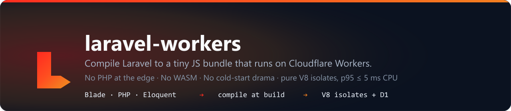

# laravel-workers

> Compile your Laravel app to a tiny JS bundle that runs on Cloudflare Workers.
> No PHP at the edge. No WASM. No cold-start drama.

[](https://github.com/arfoux/laravel-workers/actions/workflows/ci.yml) [](https://www.npmjs.com/package/laravel-workers) [](LICENSE) [](docs/CI.md)



---

```bash
cd my-laravel-app        # a real app: Laravel ≥ 10, with vendor/

npx laravel-workers deploy --plan --mode 3 --d1-auto   # the whole deploy on paper: no build, no writes
npx laravel-workers build                             # compile only, no cloud — strict
npx laravel-workers deploy                            # build → (D1) → (deploy), asking only what it cannot decide
```

That is the whole setup: nothing to install (`npm i -D laravel-workers` only if you want the version pinned in the app), no PHP at the edge, no WASM, no container. `deploy --plan` and `build` never talk to Cloudflare — `deploy` is the only verb that does.

A plan is the whole deploy on paper: the worker name, the account a real run would target, the D1 action and identity, the schema decision, the files it would touch and the cloud calls it would make — and it stops on the things a real run would stop on. Ran without `--mode 3`, `--plan` previews mode 1 (build only), which is why the line above passes it.

**What this is.** A build-time compiler, not a runtime. Your Laravel app stays the source of truth on your machine; `laravel-workers build` turns Blade, routes, models and config into a small ESM bundle, and a Cloudflare Worker runs that bundle as pure JS against D1. The 55-case Blade corpus is checked **byte-identical against PHP 8.3 on your machine**; the shadow replay records remaining divergences instead of hiding them. For non-scaffold builds, the build fails on unaccounted routes and refused constructs. Published 0.5.1 had one skipped-controller gap (P7); it is **fixed on main after 0.5.1, not yet published** — see [docs/EVIDENCE.md](docs/EVIDENCE.md).

```
Laravel app (your machine)                Cloudflare Worker (request time)
  npx laravel-workers build        →        dist/src/worker.mjs
    Blade → PHP → JS  (byte-parity)         0 PHP · 0 WASM · V8 isolate
    routes · models · config → JS           D1 · KV · R2 when bound
       ↓ wrangler deploy
```

For contrast: running PHP itself at the edge (Octane, WASM, a warm PHP host) boots Laravel per request at **~1000–2000 ms CPU**. This rung's **5 ms CPU p50 / 41 ms p95** are probe-only platform `cpuTime` numbers from the `lw-cpu-probe` worker (`COMPILED.md` → benchmarks), not a measurement of your app or of `lw-showcase`; a fresh Cloudflare benchmark was excluded by this audit. Laravel stays Laravel — this is a toolchain, not a framework fork.

<!-- readme-counts:start -->
```
constructs   54 compile · 57 fail loud · 7 documented   (118 audited)
facades      47/47 classified (100%)
blade corpus 55 cases in manifest (parity: npm run test:corpus)
docs         105/105 pages with a verdict
```
<!-- readme-counts:end -->

These counts are self-checks: the facade percentage compares a hand-maintained table with its
own total (a real census runs in the CI e2e job), and the docs count checks that MAP coverage-index
rows carry a verdict glyph. Neither is a correctness proof for the underlying claim.

Needs: PHP **≥ 8.3 on the build machine only**, Node ≥ 22, a Laravel ≥ 10 app, a Cloudflare account. **Free plan first** — the toolchain is shaped for it; R2 is the only product that asks for a card, and the build never turns it on by itself.

---

## The commands

| Command | What it does |
|---|---|
| `deploy --plan [--mode 2|3] [--check]` | preview: no build, no app/config/cloud writes, no prompts; `--mode 3` previews the deploy (plain `--plan` is mode 1 = build only); `--check` requires mode ≥ 2 and adds read-only account/D1 checks using temporary scratch files that are cleaned up |
| `build` | compile to `dist/` — no cloud; for non-scaffold builds, strict (an unaccounted route fails the build); `--scaffold` writes `501` stubs |
| `deploy` | build → (D1) → deploy; `--mode 1\|2\|3`, `--d1-auto`, `--d1-id <uuid>`, `--skip-schema`, `--yes` |
| `status` | the recorded deploy state: worker, account, URL, deployed-at, D1 name/id, schema |
| `doctor [--cloud]` | preflight: PHP, vendor, wrangler, deploy state |
| `verify` | re-check the S0 boot context; requires a prior build's `welcome.compiled.json`, otherwise prints `VERIFY-S0 SKIP` and exits 0 |
| `shadow --app <root>` | proof harness: the real PHP app against the compiled worker |
| `init` | write `registry.json` + `wrangler.jsonc` up front (idempotent — a build scaffolds `wrangler.jsonc` when absent; `registry.json` is init-only) |
| `vendor:ensure` / `php:ensure` | provisioning helpers for manual or caller-CI use (this repo's CI does not invoke them) |

Every flag, the tested versions and the tier order: **[docs/DEPLOY.md](docs/DEPLOY.md)**.

---

## What runs today

The short version. Per construct: **[COMPILED.md](COMPILED.md)**. The map: **[MAP.md](MAP.md)**.

| Area | Today |
|---|---|
| **Blade** | layouts, sections, includes, conditionals, loops, `@switch`, ternary/`??`, `e()`, `__()`, casts — the 55-case corpus is byte-identical to the PHP 8.3 oracle; data-rendering pages are not proven byte-identical |
| **Router** | `{param}`/`{param?}`, a param inside text in one segment, domains, `->where()` (Symfony's `RouteCompiler`), `fallback`, redirects, auto `OPTIONS`, 405 with the app's error view, `ValidatePathEncoding` → 400 before the router. In Laravel 13 `{param*}` is literal text, not a catch-all |
| **Controllers** | `GET/POST/PUT/PATCH/DELETE`, class-method resolution, simple `Request`/FormRequest injection, `response()`/`json()`, `redirect()->intended()`, session rotation, class constants; conditional FormRequest rule objects are refused (LW003) |
| **Eloquent** | `find`/`where*`/`orderBy*` + `first`/`get`/`count`/`pluck`, `hasMany`/`belongsTo` from the compiled model dump (`hasOne` works in the kernel but is not dumped yet), `create`/`updateOrCreate`/`firstOrCreate`, `fillable` + mutators + casts (`json`, `decimal:N`, `hashed`), `refresh`/`increment`, soft deletes, route-model binding |
| **Auth + session** | `SessionGuard` (attempt/login/logout/remember/recaller), `EloquentUserProvider`, `BcryptHasher` (`$2y$` parity), remember-me rotation, `auth`/`guest`/`auth.basic`, flash data + CSRF, `ThrottleRequests` over the D1 cache |
| **Validation** | the compiled rule surface incl. `unique`/`exists` over D1 (single database only), pipe-safe regex, `nullable`/`sometimes`/`bail`, wildcard display names, Laravel 13 messages; `active_url`, `mx_record`, `encoding`, `current_password`, SVG/image allowances and custom `Validator::extend()` rules are refused |
| **D1 + storage** | query builder (`where(fn)`, `join`/`group`/`having`/`distinct`, `whereDate`…, `sum`/`avg`/`chunk`, `upsert`, D1-safe param binding), D1-backed cache at request time (KV is build-time/simple-cache only), `Storage::put/get/exists/delete` (default disk = D1 blob store, R2 when bound), multipart uploads + the `file` rule |
| **Framework bits** | `Gate`/policies compiled at build time, policy `before()` honoured (global `Gate::before()` is refused), `Event::dispatch` (listeners compiled, synchronous), `paginate()` → byte-identical Tailwind links, `Mail::to()->send()`, the schedule dumped to `dist/cron.json` + the `scheduled` handler |

**Refused at build time for non-scaffold builds** — never answered wrongly, each with an escape hatch (recipes in **[docs/PACKAGE-PORTS.md](docs/PACKAGE-PORTS.md)**): `<x-...>` components and controller code outside the transpiler subset → a `ports/*.mjs` handler · `Queue::push()` → CF Queues + a consumer you write, or a D1 table a cron reads · `Cache::tags()` · CORS config · a named non-default `Storage::disk()` → bind R2 · a `config()` group the app has not declared → declare it in `registry.json` · an `auth.guards.*` driver you registered in PHP → a guard port. `npx laravel-workers build --scaffold` writes a `501` stub for every route that needs one.

### Honest limits

- **No queue worker.** `Queue::push()` fails the build; the schedule side (`dist/cron.json` + the `scheduled` handler) is compiled and does run.
- **Prerendered pages are prerendered with an empty table.** A snapshot that reads rows the build has never seen looks like the page with no data — run it against real data after the schema apply, or route it explicitly.
- **Storage depth is a plan decision.** The default disk is the D1 blob store (1.5 MB/object, no card). A named disk, a bigger object or many objects means R2, which asks for a payment method.
- **Livewire is out of v1** — `MAP.md` calls it hard and Inertia a feasible phase-3 JSON port. What compiles is the Blade/PHP subset the corpus and the oracle cover; the rest is a port you write.
- **Ports have recorded runtime gaps:** the AI SDK's SSE stream, MCP over STDIO/SSE — [docs/PACKAGE-PORTS.md](docs/PACKAGE-PORTS.md) names each one.

## Local git safety hooks

Two hooks guard this repo against the two git mistakes that happened here before: a bulk
`git add -A` sweeping another session's work into a commit, and an unapproved history
rewrite. They live in `.git/hooks/` — local to this clone, deliberately **not** committed,
not shipped in the tarball, and absent from a fresh clone. The blocks below are condensed
renditions of what each guard enforces; the runnable scripts exist only in this clone's
`.git/hooks/`, together with their incident rationale.

| Hook | What it blocks | Decision variable (set by the user, never by the agent) |
|---|---|---|
| `.git/hooks/pre-commit` | any commit with more than `LW_STAGED_LIMIT` staged files (default `25`) | `LW_BIG_COMMIT_OK=1 git commit ...` |
| `.git/hooks/pre-push` | a non-fast-forward push (`--force` / `--force-with-lease`) or a remote branch deletion | `LW_ALLOW_FORCE=1 git push --force-with-lease ...`, `LW_ALLOW_DELETE=1 git push origin --delete <branch>` |

Condensed enforcing logic (the hook files carry the full scripts and their incident rationale):

```sh
# .git/hooks/pre-commit
STAGED_LIMIT="${LW_STAGED_LIMIT:-25}"
count=$(git diff --cached --name-only | wc -l | tr -d ' ')
if [ "$count" -gt "$STAGED_LIMIT" ] && [ "${LW_BIG_COMMIT_OK:-}" != "1" ]; then
  echo "pre-commit: $count files staged (limit $STAGED_LIMIT)." >&2
  exit 1
fi
```

```sh
# .git/hooks/pre-push — one line from the ref list on stdin
case "$local_sha" in
  0000000000000000000000000000000000000000)  # deleting a remote ref
    [ "${LW_ALLOW_DELETE:-}" = "1" ] || exit 1 ;;
esac
if ! git merge-base --is-ancestor "$remote_sha" "$local_sha" 2>/dev/null \
   && [ "${LW_ALLOW_FORCE:-}" != "1" ]; then
  echo "pre-push: $remote_ref is NOT a fast-forward." >&2
  exit 1
fi
```

Normal flow stays selective commit-by-path (`git add <named-file>`), never `git add -A` or
`git add .`. The full scripts, including their incident rationale, are in
`.git/hooks/pre-commit` and `.git/hooks/pre-push`.

---

## Where to read next

| Question | File |
|---|---|
| every CLI flag, the guided deploy, the tiers, exit codes, refusals | [docs/DEPLOY.md](docs/DEPLOY.md) |
| what compiles, what refuses, per construct | [COMPILED.md](COMPILED.md) |
| the app → edge map, D1 limits, the to-verify list | [MAP.md](MAP.md) |
| guard / route / middleware ports, the 56 route-port slugs in the example registry | [docs/PACKAGE-PORTS.md](docs/PACKAGE-PORTS.md) |
| what the verdict badge means (the app-facing CI contract) | [docs/CI.md](docs/CI.md) |
| what changed, when | [CHANGELOG.md](CHANGELOG.md) |
| what was actually run against a real app — and what was not, with the commands and their output | [docs/EVIDENCE.md](docs/EVIDENCE.md) |
| **working on the toolchain? start here** — the suite, the checks, the build internals, the full doc map | [docs/DEVELOPING.md](docs/DEVELOPING.md) |

## Philosophy

- **Laravel stays Laravel** — this is the toolchain, not a framework fork.
- **Coverage enforced** — unhandled route = warning; `--strict` = failure. Published 0.5.1 violated this for one skipped controller (P7); the fix is on main after 0.5.1, not yet published.
- **Free-plan-first** — paid is headroom, never a fallback; the build says exactly what the app needs.
- **Honest claims** — no "approach in progress" before M1 was measured; a fresh scoped prior-art scan ran on 2026-11-26 and found no equivalent (`docs/CLAIM-COVERAGE.md` row 49). Re-scan before any new public claim that widens the scope.

## License

MIT — see [LICENSE](LICENSE). Trademarks belong to their owners.
